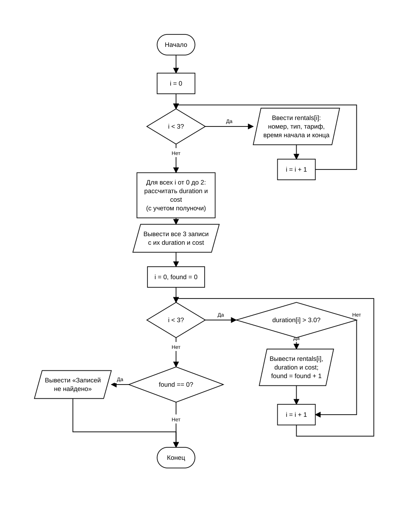

# Домашнее задание к работе 11

## Условие задачи (Вариант 2)

Создать структуру для хранения записи «Прокат велосипеда».

Поля записи:
- номер велосипеда;
- тип велосипеда;
- стоимость аренды за час;
- время начала аренды;
- время окончания аренды.

Организовать ввод трех значений структур. Выполнить обработку 3 переменных структурного типа:
1. Вычислить продолжительность и стоимость каждой аренды (с учетом возможного перехода через полночь).
2. Вывести все записи с рассчитанными характеристиками.
3. Отфильтровать и вывести записи, в которых продолжительность аренды превышает 3 часа.

---

## 1. Алгоритм и блок-схема

### Алгоритм

1. Задать константы: количество записей `COUNT = 3` и пороговое значение длительности `LIMIT_HOURS = 3.0`.
2. Описать структуру `Time` с полями часов и минут для представления времени, а также структуру `BikeRental` со всеми полями записи проката.
3. Настроить локализацию для корректного отображения русскоязычных сообщений в консоли.
4. В цикле от 0 до 2 запросить у пользователя и считать данные для 3 записей проката: номер велосипеда, тип, стоимость аренды за час, время начала (часы, минуты) и время окончания (часы, минуты).
5. Вызвать функцию обработки `process_rentals`:
   - В цикле по всем записям рассчитать длительность проката с помощью функции `calculate_duration` (если время окончания меньше времени начала, учитывается переход через полночь добавлением 24 часов).
   - Вычислить стоимость аренды как произведение длительности на часовой тариф.
   - Вывести на экран информацию по каждой из 3 записей проката.
   - В отдельном цикле проверить условие `duration > LIMIT_HOURS`. При выполнении условия вывести запись на экран и увеличить счетчик найденных записей `found`.
   - Если ни одна запись не превысила 3 часов (`found == 0`), вывести соответствующее сообщение.
6. Завершить выполнение программы.

### Блок-схема



*Исходник схемы для draw.io: [Lab11_AlgSchema.drawio](Lab11_AlgSchema.drawio)*

---

## 2. Реализация программы

Исходный код программы: [Source.c](Source.c)

---

## 3. Результаты работы программы

Пример работы программы при вводе 3 записей (включая дневные аренды и аренду с переходом через полночь):

```
Программа учета проката велосипедов

Ввод данных для записи 1:
Введите номер велосипеда: 101
Введите тип велосипеда: Горный
Введите стоимость аренды за час (руб): 250
Введите время начала аренды (часы и минуты): 10 00
Введите время окончания аренды (часы и минуты): 14 30

Ввод данных для записи 2:
Введите номер велосипеда: 102
Введите тип велосипеда: Городской
Введите стоимость аренды за час (руб): 150
Введите время начала аренды (часы и минуты): 16 00
Введите время окончания аренды (часы и минуты): 18 15

Ввод данных для записи 3:
Введите номер велосипеда: 103
Введите тип велосипеда: Шоссейный
Введите стоимость аренды за час (руб): 300
Введите время начала аренды (часы и минуты): 22 00
Введите время окончания аренды (часы и минуты): 1 45

--- Все записи проката ---

Запись 1:
  Номер велосипеда: 101
  Тип: Горный
  Тариф: 250.00 руб/ч
  Время аренды: 10:00 - 14:30
  Продолжительность: 4.50 ч
  Стоимость: 1125.00 руб

Запись 2:
  Номер велосипеда: 102
  Тип: Городской
  Тариф: 150.00 руб/ч
  Время аренды: 16:00 - 18:15
  Продолжительность: 2.25 ч
  Стоимость: 337.50 руб

Запись 3:
  Номер велосипеда: 103
  Тип: Шоссейный
  Тариф: 300.00 руб/ч
  Время аренды: 22:00 - 01:45
  Продолжительность: 3.75 ч
  Стоимость: 1125.00 руб

--- Записи с продолжительностью аренды более 3 часов ---

Запись 1:
  Номер велосипеда: 101
  Тип: Горный
  Тариф: 250.00 руб/ч
  Время аренды: 10:00 - 14:30
  Продолжительность: 4.50 ч
  Стоимость: 1125.00 руб

Запись 3:
  Номер велосипеда: 103
  Тип: Шоссейный
  Тариф: 300.00 руб/ч
  Время аренды: 22:00 - 01:45
  Продолжительность: 3.75 ч
  Стоимость: 1125.00 руб
```

---

## 4. Информация о разработчике

- **ФИО:** Аносов Сергей Юрьевич
- **Группа:** бОТИ-261
